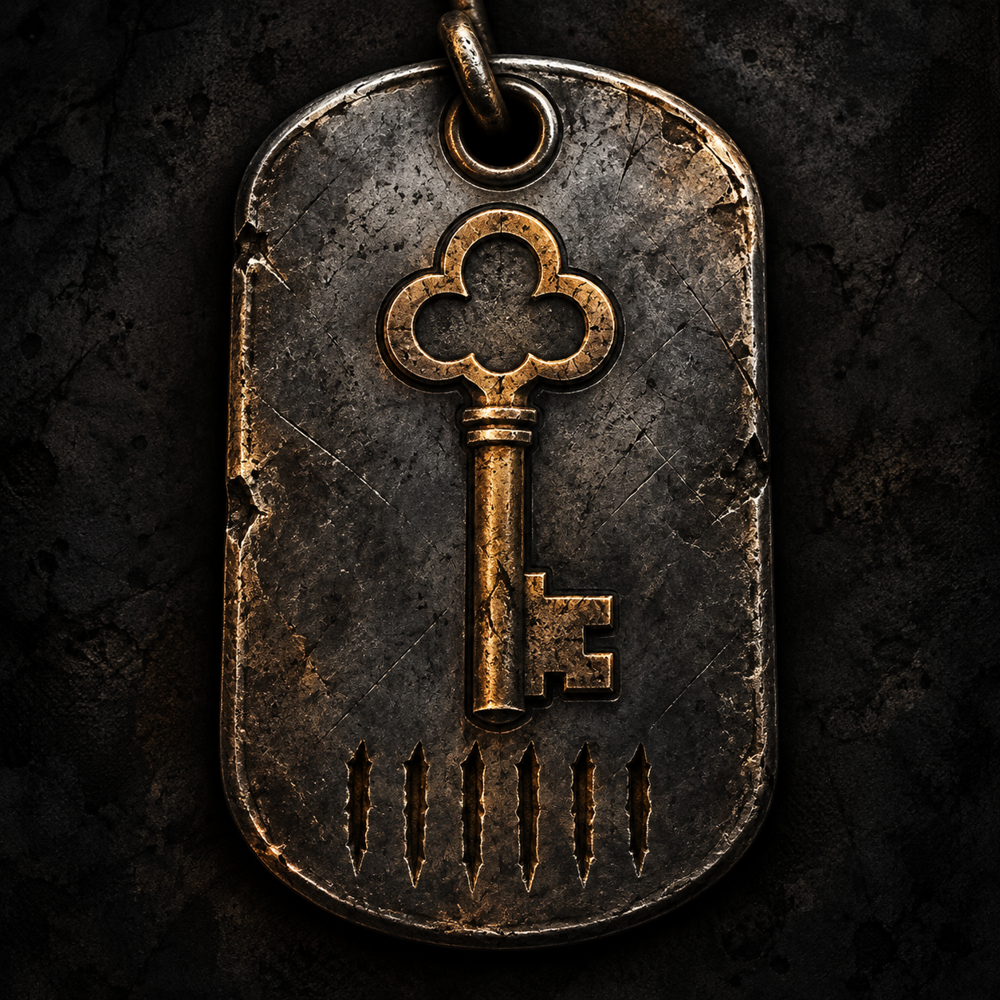

# Hardcore Progression



**Quest recovery barters earned through raids, for SPT 4.1.6.** Standalone server mod with a companion BepInEx plugin for quest-description counters. Version **2.0.0**, by **forcedroidbrain**.

[Русское описание](README.ru.md)

HardcoreRules, Barterizer, Better Keys, QuestBackport and LocalStackLimits are **not required**. The mod adds its own quest barters; it does not convert the normal trader economy or enforce a complete hardcore ruleset.

## How progression works

- The curated catalog contains **178 quest/item pairs**: 79 key entries at Therapist and 99 weapon-part entries at Mechanic. These are offers, not unique-item counts, and are not a promise to cover every quest or every possible Gunsmith build.
- Accept a supported quest, then complete **6 PMC raids** while that same quest assignment remains active at the start and end of each raid. Survived, killed, run-through and missing-in-action results count. Scav raids, transit, aborted raids, unmatched results and failed raid saves do not count.
- The corresponding item barters become available while the quest remains active. Each purchase provides **one item without Found in Raid status**.
- After buying an item, that offer requires **6 new raids after purchase**. Other offers for the same quest remain independent; surplus raids before purchase do not bypass the repeat wait.
- Completing/restarting the quest or changing profiles cannot transfer its unlocks. Existing vanilla quest requirements and objectives remain unchanged.
- The companion plugin displays raid progress and repeat waits above the original quest description in trader and task panels. It keeps the original description, including other mods' text.

Recipes use normal SPT barter payment rules; the mod does not impose an additional FIR requirement on ingredients. It does not provide complete Gunsmith weapons or quest pickup items.

## Installation

1. Back up your profile, then close the game and server.
2. Extract `HardcoreProgression-2.0.0.zip` into the **SPT root** containing `SPT_Runtime` and `BepInEx`.
3. Confirm both files exist:
   - `SPT_Runtime/user/mods/HardcoreProgression/HardcoreProgression.dll`
   - `BepInEx/plugins/HardcoreProgression/HardcoreProgression.Client.dll`
4. Review `config.json` in the server mod folder. The shipped defaults enable quest progression and leave medicine/container changes disabled.
5. Restart the server and game. Check the `[HardcoreProgression]` startup summary and a supported active quest's description.

The server component enforces progression even without the companion plugin; the plugin supplies the counters. Install both for the complete interface. Both components use GUID `com.forcedroidbrain.hardcoreprogression` and version `2.0.0`.

Do not install alongside the private `Local-HardcoreProgression` prototype. To migrate from that prototype, remove its old server/client folders while stopped, keep a backup, and move its `raid-progress.json` into the new server folder if you want to retain progress. Ledger version 2 and the existing offer-ID formula are retained. Review the new settings manually; the old combined config is not a replacement for the new `config.json`/`offers.json` pair.

## Configuration and languages

Settings and technical documentation use English. [Configuration reference](docs/configuration.md) documents every setting, the shipped recipes and the catalog format.

| Setting | Default | Effect |
| --- | --- | --- |
| `Enabled` | `true` | Enable progression; false also skips the optional starter kit |
| `RaidsPerExchange` | `6` | Completed PMC raids required for first and repeat purchases |
| `EnableMedicineLimits` | `false` | Restrict configured cash medicine listings to one offer per item at Therapist |
| `EnableSecureContainerLimit` | `false` | Set eligible secure-container grids to 2x2 after saved-PMC-inventory checks |
| `EnableHardcoreStarterKit` | `true` | Apply the minimal kit only if `Hardcore Playthrough` already exists |
| `ServerMessageLanguage` | `en` | Rejected-purchase message language; unsupported codes fall back to English |
| `WriteExchangeCatalog` | `false` | Write the catalog of available, resolved offers for diagnostics |

The optional medicine and container changes apply across the server, including existing profiles. They are not automatically scoped to a HardcoreRules profile. The kit affects only the new-profile template for BEAR and USEC; existing characters, login, death and raid hooks do not grant starter items.

`offers.json` is the editable catalog. Missing quests/items/traders are skipped. Invalid recipes stop initialization with an error rather than introducing an invalid barter. `starter-kit.json` contains the optional minimal PM/supplies loadout.

`locales/en.json` is the required fallback and `locales/ru.json` supplies Russian. The client selects the game language; unsupported languages use English. Item names in repeat counters use SPT's current item localization. Custom translations can be added as `locales/<language>.json`; preserve keys and format placeholders. Restart the server after changes.

## Optional integrations

**Hardcore Rules 3.1.0:** supplies restrictions such as disabling insurance, Scav raids, post-raid healing and cash offers. Hardcore Progression does not edit its config or bundle its files. If its `Hardcore Playthrough` template is present, the optional kit replaces only that new-profile template's playable starting items. Missing or incompatible templates are skipped without changing the original. Assortment hooks re-add quest barters around HardcoreRules restore/filter operations. Its whitelist-only mode is respected; whitelist the relevant items/categories or traders to expose those offers.

**SPT Barterizer 0.1.3:** converts eligible normal cash offers into item barters. Hardcore Progression supplies separate quest recovery offers; Barterizer preserves them as existing item barters. Barterizer is optional and is not a complete replacement for HardcoreRules restrictions. In particular, excluded offers and offers that cannot be converted may remain cash.

Neither integration grants compatibility with arbitrary future versions. Fika is untested; this release targets single-player SPT. Mods that replace trader assortments, quest descriptions or raid saving need additional compatibility checks. LocalStackLimits is not required; this mod does not alter special-slot filters.

## My mods

**[SPT Barterizer on Forge](https://sp-mod.com/mod/3195/spt-barterizer)** · [Source and releases](https://github.com/forcedroidbrain/SPT-Barterizer)

Turns eligible cash trader offers into item barters while preserving existing barters, offer IDs and normal unlock requirements. Use it alongside Hardcore Progression when you want the regular trader economy to favor looted materials as well as the quest recovery offers. Install it separately; it is optional.

## Saves, removal and network activity

Progress is kept in `raid-progress.json` in this mod's server folder. Back it up with the SPT profile. Do not edit it while the server is running. A damaged ledger locks this mod's exchanges instead of unlocking them. Purchases and raid rewards still use normal SPT profile saving; the separate ledger is not a transactional replacement for SPT backups.

To uninstall, stop the game/server and remove this mod's server and client folders. Preserve the ledger if you may reinstall. Items already purchased remain normal SPT items, and starter supplies already granted to a created profile are not removed. Optional template rules revert on restart unless another mod changes them. Before reverting a custom container rule, check the resulting container capacity and contents.

The companion plugin requests `/hardcore-progression/quest-progress` from the user's configured SPT backend when a supported quest description is shown. Responses contain counters for the current session, repeated-offer item IDs/names and UI translations. No external service, telemetry, updater or AI API is contacted by this mod during operation.

## Build and verification

Requires Windows, PowerShell 7, .NET 10 SDK, and a local SPT 4.1.6 client/server installation. Game/runtime DLLs are read as references and are not committed. No installer or build command deploys files into that installation.

```powershell
pwsh -File tools/Build.ps1 -SptRoot 'D:\SPT4Clean'
```

The script builds both components, runs server and client-binding checks, and creates the ZIP, SHA-256 sums and binary manifest under `dist/`. The client is compiled with Roslyn against the installation's actual Unity/.NET Standard references. Its BepInEx framework-unification warning is recorded separately from build errors.

Pass `-CompatibilityRoot 'D:\SPT4'` to also run in-process integration checks against installed HardcoreRules/Barterizer DLLs. They are read as references only; no server is launched by the build script and no installed files are changed.

Automated checks cover real SPT item/trader data, raid result/save hooks, persistence, repeat waits, profile/quest isolation, corrupted ledgers, starter-kit staging and English/Russian descriptions. [Release checks](docs/release-checks.md) distinguish automated checks, clean-server startup/API evidence and outstanding in-game validation. A startup test is not an in-game purchase test.

To run isolated server checks, provide a clean installation and, for optional scenarios, an installation containing the supported optional mods:

```powershell
pwsh -File tools/Test-CleanServer.ps1 -CleanSptRoot 'D:\SPT4Clean' -CompatibilityRoot 'D:\SPT4'
```

Only copies under this repository's ignored `artifacts/` are started. Existing user folders/profiles are excluded, dedicated ports are used, and each owned process is stopped in `finally`. Evidence folders are retained; the script refuses to overwrite them.

## AI assistance and release status

Codex was used for research, assistance with code development/revision, automated testing, and preparation of documentation. The icon was generated with OpenAI image generation. This is not a claim that every line was generated by AI. The maintainer is responsible for understanding, reviewing and validating the released code. Any Forge submission must enable **Contains AI Content**; that flag does not establish eligibility under Forge's restrictions on substantial AI-written functionality. Forge submission remains pending resolution of that requirement, in-game validation and confirmed executable scan reports.

## Attribution, license and support

MIT for this project's code. See [third-party notices](THIRD-PARTY-NOTICES.md), including the Better Keys NG data attribution and preserved MIT license. Optional mods and game/runtime assemblies are not redistributed.

Report issues at https://github.com/forcedroidbrain/HardcoreProgression/issues with versions, reproduction steps and relevant log excerpts. Do not upload profiles or private data.
